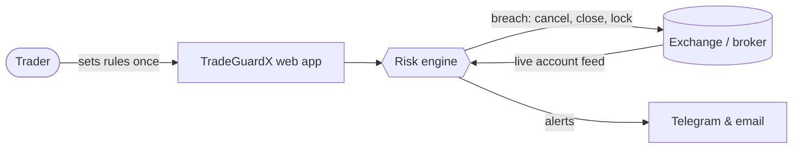

<h3>Server-side risk management for crypto and forex traders</h3>

  
  
  

---

## What we build

**TradeGuardX** enforces a trader's own risk rules on their exchange or broker account, from our servers, around the clock. A trader sets a daily loss limit, a maximum number of trades, or a pause after losses in a row. The moment a rule is broken, our risk engine cancels open orders, closes positions at market, and locks the account until the next daily reset.

It works no matter where the order came from: the exchange website, its phone app, or a bot. Nothing runs in the trader's browser, so protection holds with the laptop shut.

<table>
<tr>
<td width="33%" valign="top">

### 🛡️ Kill switch
Daily loss limit, daily profit target, max trades per day, cooldown after consecutive losses and risk per trade, enforced within seconds of a breach.

</td>
<td width="33%" valign="top">

### 🔒 Manual lock
A trader can lock their own account for a few hours or a few days before a bad session starts. It cannot be cancelled early.

</td>
<td width="33%" valign="top">

### 📊 Journal & analysis
Every trade reviewed after the fact: P&L by day, revenge-trading patterns, and a tax centre for Indian crypto traders.

</td>
</tr>
</table>

## How it works

1. **Connect** — the trader creates a trade-only API key on their exchange and pastes it in.
2. **Set rules** — limits are stored once and locked from the first trade of the day, so they can't be loosened mid-session.
3. **Enforce** — the engine holds a live connection to the account and acts on a breach in seconds, then confirms the account is flat.

## Where it runs

| Venue | Market | Status |
|---|---|---|
| **Delta Exchange** (India & Global) | Crypto futures | ✅ Live |
| **Exness** | Forex & CFDs | ✅ Live |
| **CoinDCX** | Crypto futures | ✅ Live |
| **Bybit** | Crypto derivatives | ✅ Live |
| **Shark Exchange** | Crypto futures | ✅ Live |

## Security by design

- **Trade-only keys.** We never ask for withdrawal or transfer permission and reject any key that has it. Funds never leave the trader's own account.
- **Encrypted at rest** and used only from fixed, IP-whitelisted servers.
- **No passwords, no 2FA codes.** The trader stays in full control of their exchange login and can revoke the key at any time.

## Built with

  
  
  
  
  
  
  
  

---

**[tradeguardx.com](https://tradeguardx.com)** · **[Exchanges](https://tradeguardx.com/exchanges)** · **[Pricing](https://tradeguardx.com/pricing)** · **[YouTube](https://www.youtube.com/@TradeGuardX)**

TradeGuardX is risk-management software. It does not give investment advice, trade for you, or hold your funds.

